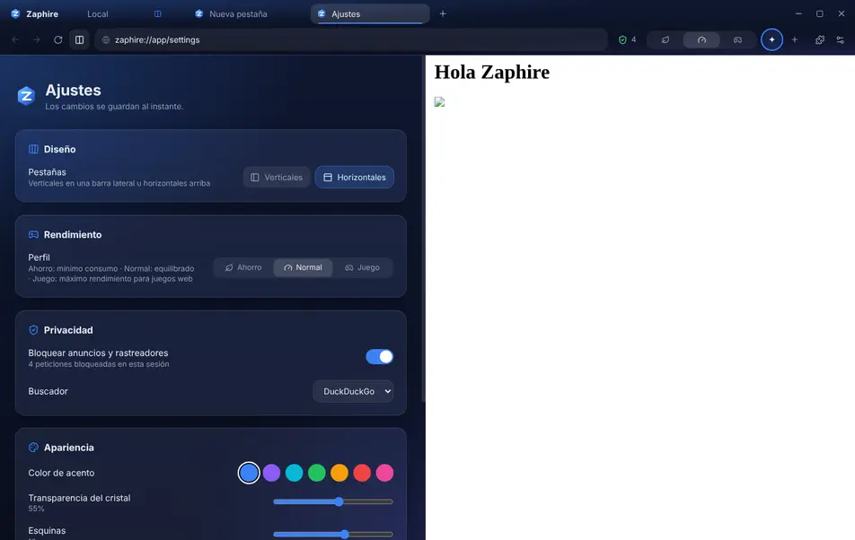

# Zaphire

Navegador web escrito en **Rust** sobre **Chromium (CEF 156)**, con interfaz
**React + Tailwind**, extensiones de Chrome, bloqueador de anuncios nativo y
perfiles de rendimiento: **Ahorro**, **Normal** y **Juego**. Para Windows y
Linux.


| Vista dividida | Pestañas horizontales |
| --- | --- |
|  |  |

## Qué hace ya (v0.1)

- **Navegación real** con Chromium 156: pestañas, atrás/adelante/recargar,
  barra de direcciones que busca o abre URLs, favicons y título.
- **Pestañas verticales u horizontales**, se cambian en vivo desde Ajustes.
- **Espacios de trabajo**: cada uno con sus propias pestañas.
- **Vista dividida**: dos pestañas lado a lado (Ctrl+Shift+S).
- **Bloqueador nativo** con el motor de Brave (`adblock-rust`), contador de
  bloqueos y listas extra en `~/.config/zaphire/filters/*.txt`.
- **Perfiles de rendimiento**
  - *Ahorro*: suspende pestañas a los 5 min y limita los procesos de render a 4.
  - *Normal*: suspende tras 30 min.
  - *Juego* (Ctrl+Shift+G): sin límite de FPS ni vsync, GPU y WebGPU forzadas,
    sin throttling, pestañas de fondo congeladas y silenciadas, y prioridad
    alta del proceso en Windows.
- **Extensiones de Chrome**: sus *content scripts* corren en todas las
  pestañas. `chrome://extensions` y la Chrome Web Store se abren en una
  ventana estilo Chrome (ver [diseño](docs/design.md#extensiones)).
- **Pantalla completa HTML5** (vídeos, juegos): oculta toda la interfaz.
- **Ventana sin marco** con controles propios
  (`ZAPHIRE_NATIVE_FRAME=1` devuelve el marco del sistema).
- **Ajustes** (`zaphire://app/settings`): acento, transparencia del
  cristal, esquinas, reducir animaciones, buscador, ancho de la barra.

### Atajos

| Atajo | Acción |
| --- | --- |
| Ctrl+T / Ctrl+W | Nueva pestaña / cerrar |
| Ctrl+L | Ir a la barra de direcciones |
| Ctrl+Tab / Ctrl+Shift+Tab | Pestaña siguiente / anterior |
| Ctrl+R, F5 | Recargar |
| Ctrl+Shift+S | Vista dividida |
| Ctrl+Shift+G | Modo Juego on/off |
| F12 | DevTools |

## Compilar

Requisitos: Rust estable (edición 2024), Node 22. En Linux, además, GTK3 y NSS.

```bash
cargo install export-cef-dir --version 156.7.0 --locked
```

```bash
export-cef-dir --force "$HOME/.local/share/cef"
```

```bash
export CEF_PATH="$HOME/.local/share/cef"
```

```bash
scripts/package.sh release
```

El resultado queda en `dist/zaphire-linux/` (lanzar con `zaphire.sh`) o en
`dist/zaphire-windows/zaphire.exe`.

Para desarrollar la interfaz sin Chromium, con un backend simulado:

```bash
cd ui && npm install && npm run dev
```

## Estructura

```
crates/zaphire-core     pestañas, espacios, vista dividida, ajustes, URLs (sin CEF, testeable)
crates/zaphire-perf     perfiles Ahorro / Normal / Juego
crates/zaphire-adblock  bloqueador (adblock-rust) + lista integrada
crates/zaphire-ipc      protocolo UI ⇄ núcleo
crates/zaphire-app      ejecutable: CEF, ventana, esquema zaphire://, manejadores
ui/                     interfaz React + Tailwind v4 + Motion
.claude/skills/         skills de las librerías de UI (Aceternity, Kobra, EasyUI, Pin UI, RareUI)
```

Arquitectura y decisiones: [docs/design.md](docs/design.md).

## Licencia

[MPL-2.0](LICENSE).
