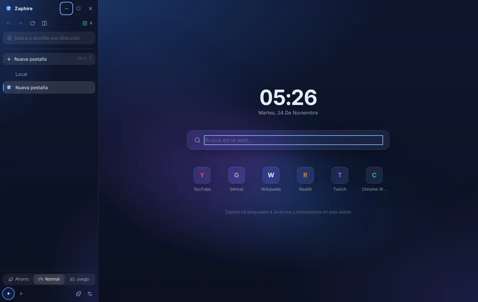
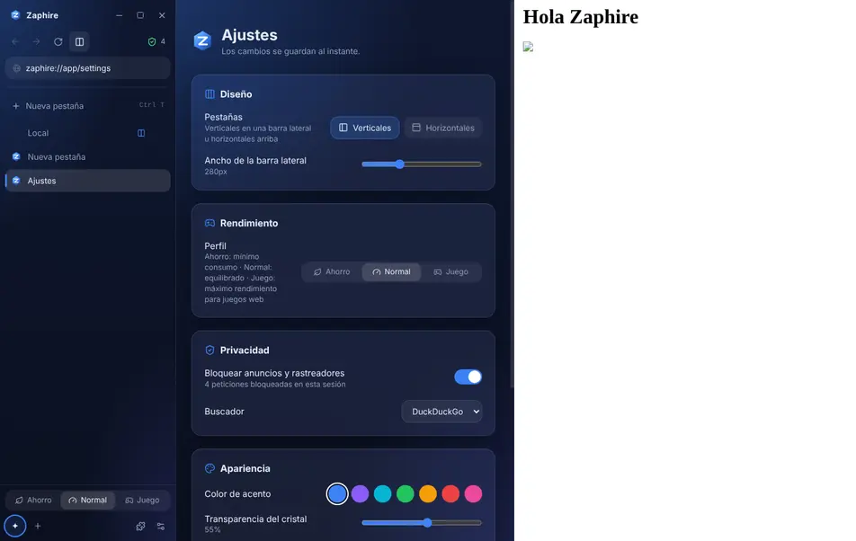

# Zaphire

Navegador web escrito en **Rust** sobre **Chromium (CEF 156)**, con interfaz
**React + Tailwind**, extensiones de Chrome, bloqueador de anuncios nativo y
perfiles de rendimiento: **Ahorro**, **Normal** y **Juego**. Para Windows y
Linux.



| Vista dividida | Pestañas horizontales |
| --- | --- |
|  |  |

## Descargar

En [Releases](https://github.com/IamSowie/Zaphire/releases) (o en los
artefactos de la última ejecución de **Actions**):

| Sistema | Archivo |
| --- | --- |
| Windows | `Zaphire-<versión>-setup.exe` (instalador, sin permisos de administrador) o `…-windows-x64-portable.zip` |
| Linux | `Zaphire-<versión>-x86_64.AppImage` (dale permiso de ejecución y ábrelo) o `…-linux-x86_64-portable.tar.gz` |

## Qué hace ya

- **Navegación real** con Chromium 156: pestañas, atrás/adelante/recargar,
  barra de direcciones que busca o abre URLs, favicons y título.
- **Pestañas verticales u horizontales**, se cambian en vivo desde Ajustes.
- **Espacios de trabajo**: cada uno con sus propias pestañas.
- **Vista dividida**: dos pestañas lado a lado (Ctrl+Shift+S).
- **Bloqueador nativo** con el motor de Brave (`adblock-rust`), contador de
  bloqueos y listas extra en `~/.config/zaphire/filters/*.txt`.
- **Perfiles de rendimiento**
  - *Ahorro*: suspende pestañas a los 5 min y limita los procesos de render a 4.
  - *Normal*: suspende tras 30 min.
  - *Juego* (Ctrl+Shift+G): sin límite de FPS ni vsync, GPU y WebGPU forzadas,
    sin throttling, pestañas de fondo congeladas y silenciadas, y prioridad
    alta del proceso en Windows.
- **Extensiones de Chrome**: sus botones salen en la barra de Zaphire y
  abren su ventana emergente flotante; sus *content scripts* corren en todas
  las pestañas. `chrome://extensions` y la Chrome Web Store se abren en una
  ventana estilo Chrome (ver [diseño](docs/design.md#extensiones)).
- **Historial y marcadores** (`zaphire://app/library`, Ctrl+H): búsqueda,
  agrupado por día, estrella en la barra de direcciones (Ctrl+D) y lista de
  marcadores en la barra lateral.
- **Restaurar sesión**: al abrir vuelven las pestañas, espacios y vista
  dividida; las pestañas no visibles quedan sin cargar hasta que las abres.
- **Pantalla completa HTML5** (vídeos, juegos): oculta toda la interfaz.
- **Ventana sin marco** con controles propios
  (`ZAPHIRE_NATIVE_FRAME=1` devuelve el marco del sistema).
- **Personalización** (`zaphire://app/settings`):
  - Tema **oscuro, claro o del sistema**.
  - Fondo **degradado o plano**, con colores predefinidos o uno a tu gusto.
  - Color de acento (predefinido o personalizado), transparencia del cristal y esquinas.
  - Tamaño de la interfaz (85–125 %) y densidad cómoda o compacta.
  - Reducir animaciones, y mostrar u ocultar marcadores y extensiones en la barra.

### Atajos

| Atajo | Acción |
| --- | --- |
| Ctrl+T / Ctrl+W | Nueva pestaña / cerrar |
| Ctrl+L | Ir a la barra de direcciones |
| Ctrl+Tab / Ctrl+Shift+Tab | Pestaña siguiente / anterior |
| Ctrl+R, F5 | Recargar |
| Ctrl+Shift+S | Vista dividida |
| Ctrl+Shift+G | Modo Juego on/off |
| Ctrl+D | Añadir/quitar marcador |
| Ctrl+H | Historial y marcadores |
| F12 | DevTools |

## Compilar

Requisitos: Rust estable (edición 2024), Node 22. En Linux, además, GTK3 y NSS.

```bash
cargo install export-cef-dir --version 156.7.0 --locked
```

```bash
export-cef-dir --force "$HOME/.local/share/cef"
```

```bash
export CEF_PATH="$HOME/.local/share/cef"
```

```bash
scripts/package.sh release
```

El resultado queda en `dist/zaphire-linux/` (lanzar con `zaphire.sh`) o en
`dist/zaphire-windows/zaphire.exe`. En Linux, `scripts/appimage.sh` crea
además el AppImage. El instalador de Windows se genera con Inno Setup
(`packaging/windows/zaphire.iss`); la CI lo hace sola.

Publicar una versión: sube una etiqueta `v*` y la CI crea la *release* con
todos los archivos.

```bash
git tag v0.2.0 && git push origin v0.2.0
```

Para desarrollar la interfaz sin Chromium, con un backend simulado:

```bash
cd ui && npm install && npm run dev
```

## Estructura

```
crates/zaphire-core     pestañas, espacios, vista dividida, ajustes, historial, marcadores, extensiones (sin CEF, testeable)
crates/zaphire-perf     perfiles Ahorro / Normal / Juego
crates/zaphire-adblock  bloqueador (adblock-rust) + lista integrada
crates/zaphire-ipc      protocolo UI ⇄ núcleo
crates/zaphire-app      ejecutable: CEF, ventana, esquema zaphire://, manejadores
ui/                     interfaz React + Tailwind v4 + Motion
.claude/skills/         skills de las librerías de UI (Aceternity, Kobra, EasyUI, Pin UI, RareUI)
```

Arquitectura y decisiones: [docs/design.md](docs/design.md).

## Licencia

[MPL-2.0](LICENSE).
